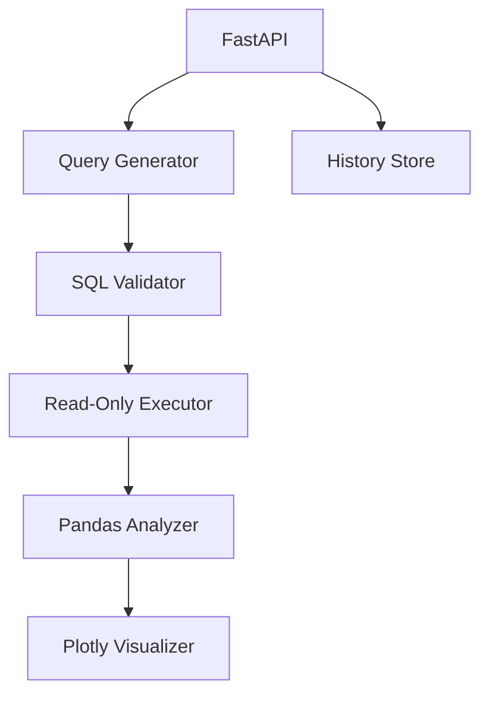

# DataPilot AI

Agentic data analyst that answers natural-language questions about structured data, generates safe SQL, executes read-only queries, analyzes results, and produces charts.

## Features

- **Natural Language Queries**: Ask questions in plain English
- **Safe SQL Generation**: LLM or deterministic SQL generation
- **SQL Validation**: Multi-layer security validation
- **Read-Only Execution**: Only SELECT queries allowed, enforced at multiple levels
- **Data Analysis**: Pandas-based analysis with insights
- **Visualizations**: Plotly charts when appropriate
- **Audit Trail**: All questions and SQL logged
- **Synthetic Dataset**: Business data (customers, orders, products, sales)

## Security

- SQL parsing and validation (not just prompt-based)
- Forbidden keywords blocked (INSERT, UPDATE, DELETE, DROP, etc.)
- Single statement only
- Read-only database permissions
- No credentials exposed to models
- Row limits and timeouts

## Quick Start

### Installation

```bash
pip install -r requirements.txt
cp .env.example .env
```

### With PostgreSQL (Docker)

```bash
docker-compose up --build
```

### Standalone (Demo Mode)

```bash
python main.py
```

Access docs at http://localhost:8001/docs

## Example Query

```bash
curl -X POST http://localhost:8001/query \
  -H "Content-Type: application/json" \
  -d '{"question": "Which product categories generated the highest revenue last month?"}'
```

## Dataset

Tables: customers, orders, products, sales with synthetic data spanning 2024-2026.

## Architecture



## Testing

```bash
pytest tests/
```

## Limitations

- Demo uses mock data when PostgreSQL unavailable
- Deterministic SQL generation for common patterns
- Limited schema introspection in demo mode
- CTEs allowed but complex ones need validation
# Updated
